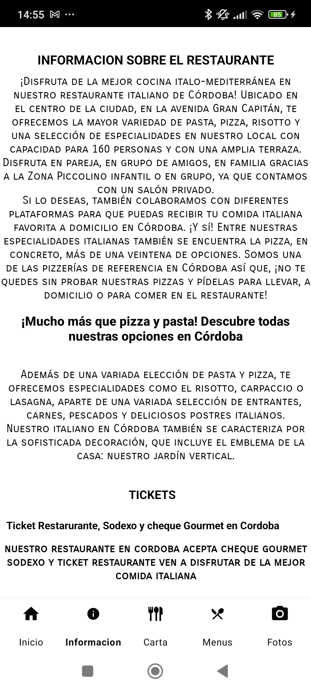
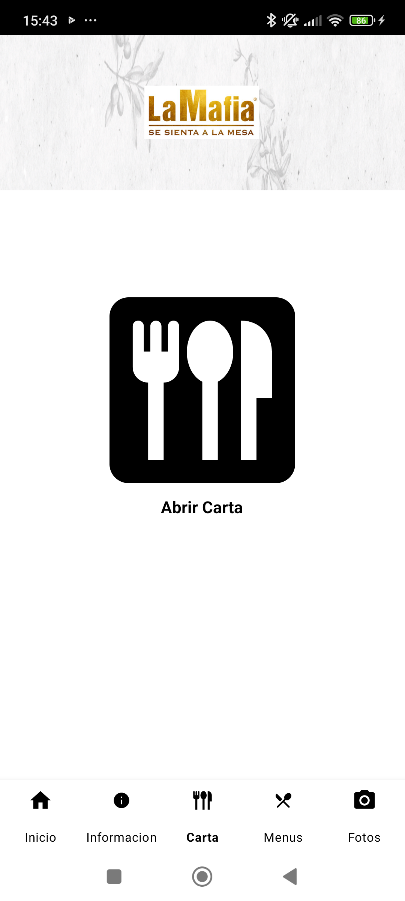
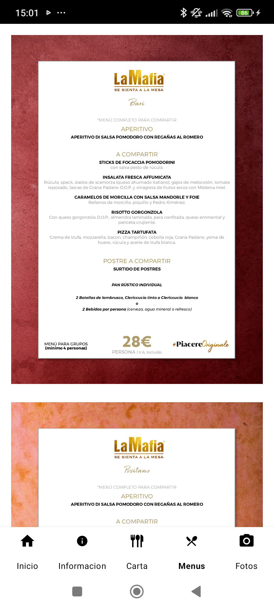
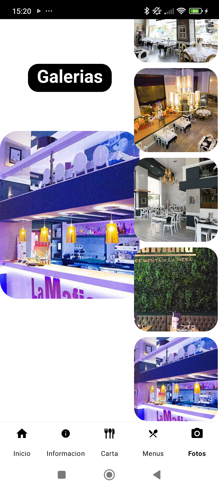

# La Mafia Se Sienta a la Mesa — App Android 🍝

App nativa Android para el restaurante italiano **"La Mafia Se Sienta en la Mesa"** (Córdoba). Proyecto desarrollado como pieza de portafolio para demostrar manejo de desarrollo Android nativo con Java y Kotlin.

## 📱 Sobre el proyecto

La app funciona como punto de contacto digital del restaurante: presenta el local, permite reservar mesa, pedir a domicilio a través de plataformas externas (Glovo, Just Eat, Uber Eats), consultar la carta y los menús especiales, y navegar una galería de fotos del local.

## ✨ Funcionalidades

- **Inicio** — video de bienvenida de fondo, acceso directo a reserva de mesa y pedidos a domicilio
- **Información** — datos del restaurante, mapa interactivo de Google Maps con la ubicación, horarios y medios de pago aceptados
- **Carta** — acceso directo a la carta digital del restaurante
- **Menús** — galería de menús especiales para compartir (Bari, Positano, etc.)
- **Fotos** — galería del local con selector de imagen ampliada
- Llamada directa al restaurante desde la app

## 🛠️ Tecnologías

- **Java** sobre Android SDK (Views + Fragments) — pantallas de la app
- **Kotlin** — configuración de tema para Jetpack Compose incluida en el proyecto
- **Material Components** — `BottomNavigationView` para la navegación principal
- **Glide** — carga, recorte (`centerCrop`) y esquinas redondeadas de imágenes
- **Google Maps / Location Services**
- **Volley**
- **Gradle** (Groovy DSL)

## 📂 Arquitectura

`MainActivity` aloja una `BottomNavigationView` que intercambia fragments dentro de un contenedor (`InicioFragment`, `InformacionFragment`, `CartaFragment`, `MenusFragment`, `FotosFragment`), cada uno con su propio layout y lógica.

- `minSdk` 21 · `targetSdk`/`compileSdk` 34

## 🚀 Cómo ejecutar el proyecto

1. Clona el repositorio
2. Ábrelo en Android Studio (versión reciente recomendada)
3. Crea un archivo `secrets.properties` en la **raíz** del proyecto (mismo nivel que `settings.gradle`) con tu propia API key de Google Maps:

   ```properties
   MAPS_API_KEY=TU_API_KEY_AQUI
   ```

   Este archivo está en `.gitignore` y no se sube al repo — cada quien usa su propia key.
4. Sincroniza Gradle y ejecuta en un emulador o dispositivo físico

## 📸 Capturas

| Inicio | Información | Carta |
|---|---|---|
|  |  |  |

| Menús | Fotos |
|---|---|
|  |  |

## 👤 Autor

**Nelson Villalba Vergara**

## 📄 Licencia

Proyecto educativo / de portafolio. Todos los derechos sobre el código fuente, diseño y recursos visuales pertenecen a Nelson Villalba Vergara. Queda prohibida la reproducción, distribución o modificación no autorizada.
